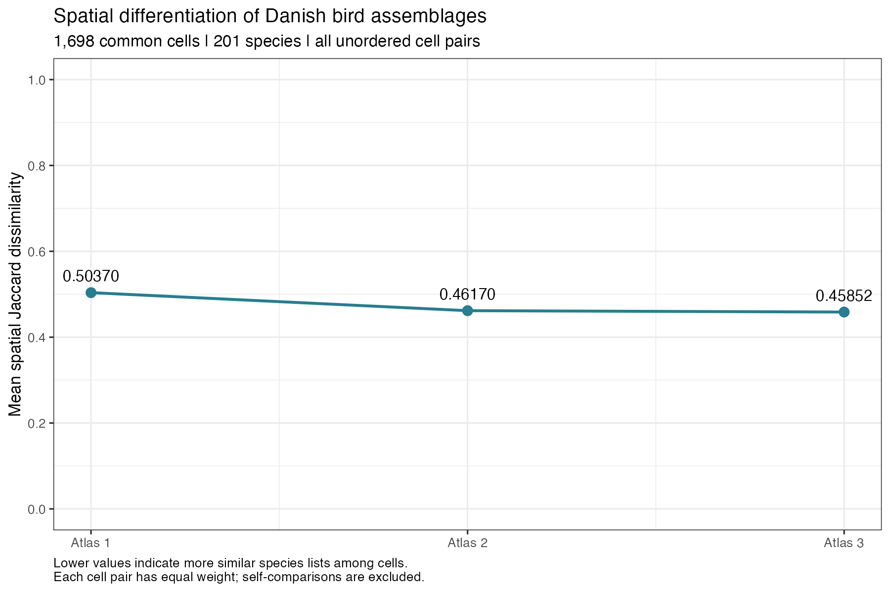
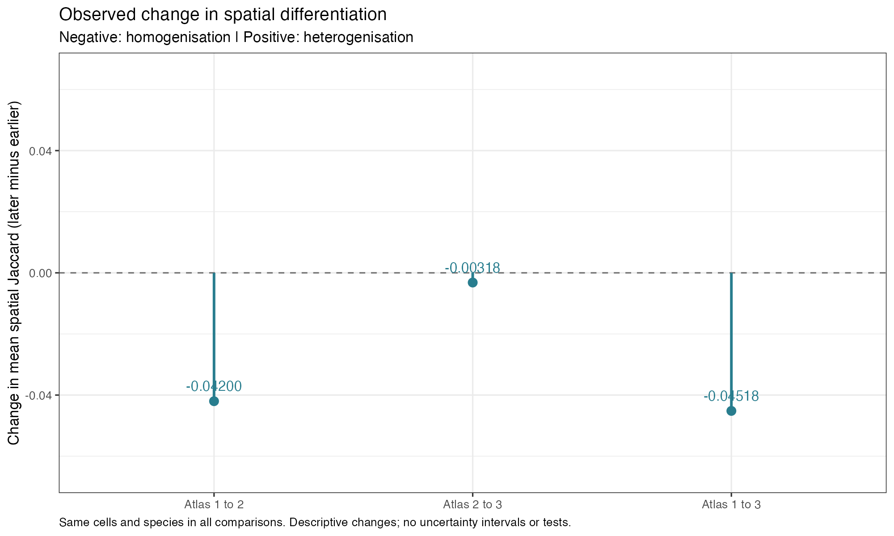

# Observed homogenisation of Danish bird assemblages

## Question and method

Following question five and its cookbook in Carsten’s `material/supp-analyses/Possibilities for Danish BirdAtlas Analysis of changes over time..pdf` (pp. 13–15; appendix code p. 26).

Within each atlas, compare every unordered pair of different cells. Jaccard dissimilarity is the number of species present in only one of the two cells divided by the number present in either cell. Shared absences do not enter this denominator. Average these distances with equal weight per pair, then subtract the earlier atlas mean from the later atlas mean.

This compares different cells within each period; it is not temporal turnover of a cell’s own species list.

## Shared data and inclusion rules

- Occurrences: `data-new/0-pre/raw/occurrences/Y_occurrences.csv`.
- Cell/atlas identities: `data-new/0-pre/raw/design/studyDesign.csv`.
- Land cover: `data-new/0-pre/derived/environmental/X_environment.csv`. Retain cells with `pct_class_0 + pct_class_77 <= 75` in every atlas: at least 25% land, excluding ocean and inland water.
- Coverage: `data-new/0-pre/raw/effort/dækning atlas1+2.xlsx`. Retain codes 1 and 2 (Good/Average) in both Atlas 1 (`UNDS_KODE_`) and Atlas 2 (`UNDS_KOD_1`). Atlas 3 coverage is assumed adequate, not measured by this workbook.
- Use the intersection across all three atlases, matching the current occupancy-change and unusual-temporal-turnover scripts. Keep all upstream species, including genuine zero-occurrence species within an atlas; apply no additional rarity filter.
- Missing or nonbinary occurrence values stop execution. Empty communities also stop execution for an explicit policy decision; no cells are silently removed and no undefined distances are recoded.

Validated sample: **1,698 cells × 201 species**, with **1,440,753 unordered pairs per atlas**. Empty communities: 0, 0, 0 in Atlases 1, 2 and 3.

## Results

| Atlas | Mean spatial Jaccard |
| --- | ---: |
| 1 | 0.50370173 |
| 2 | 0.46169780 |
| 3 | 0.45852245 |

| Atlas comparison | Change (later minus earlier) | Observed direction |
| --- | ---: | --- |
| 1-2 | -0.04200393 | Homogenisation |
| 2-3 | -0.00317535 | Homogenisation |
| 1-3 | -0.04517929 | Homogenisation |

From Atlas 1 to Atlas 3, mean spatial Jaccard changed from 0.50370 to 0.45852 (-0.04518), indicating observed homogenisation on this fixed grid.





## Interpretation and limits

Negative changes mean that species lists became more similar on average (homogenisation); positive changes mean they became less similar (heterogenisation). These are complete descriptive summaries of the defined recorded-occurrence dataset. Pairwise distances are dependent and are not treated as independent replicates.

The national all-pairs mean mixes nearby and distant comparisons and can conceal regional differences. Changes in richness and species occupancy may accompany the pattern. These results do not establish causes, correct for detection differences, or show departures from a random-allocation expectation. The descriptive script calculates no p-values. The separate paired spatial-block bootstrap runner supplies exploratory intervals in the R Markdown report. The separate independent-change null runner compares observed spatial change with baseline-fixed allocation of species gains and losses. Coverage validation, replacement/nestedness partitions and local analyses remain deferred.

## Reproduce and validate

From the repository root:

```sh
Rscript scripts/1-atlas-analyses/homogenization/homogenization.R
```

Or run `Rscript homogenization.R` from this folder. Requires R packages `readxl` and `ggplot2`. The script regenerates this report and the two PNGs; calculations remain available as `atlas_summary`, `changes`, `sites` and `matrices` when sourced into R.

Checks cover binary values before conversion, aligned cell/species identities, duplicate identifiers, empty communities, pair counts, distance bounds and symmetry, zero self-distance, direct logical intersection/union checks on selected cell pairs, and the identity that changes 1–2 plus 2–3 equal change 1–3.

Report generated: 2026-11-05
R version: 4.5.2

## Stage-one spatial diagnostics

The script also produces cell-contribution, quadratic-trend and residual maps, and raw/detrended directional semivariograms with pair counts. See `homogenization.Rmd` and its rendered HTML for definitions, checks and interpretation. Requires `sf`; report rendering additionally requires `rmarkdown`, `knitr` and Pandoc.

From the repository root:

```sh
Rscript -e 'rmarkdown::render("scripts/1-atlas-analyses/homogenization/homogenization.Rmd")'
```

Additional in-memory objects: `cell_diagnostics`, `trend_summary`, `variogram_summary` and `regional_diagnostic_summary`. All figures are PNGs. Run `Rscript scripts/1-atlas-analyses/homogenization/run-spatial-bootstrap.R --replicates=2000 --seed=20261105` explicitly to save bootstrap results. Rendering reads completed compatible results without rerunning the bootstrap. No block width is selected automatically.

## Conditional allocation null

Run `Rscript scripts/1-atlas-analyses/homogenization/run-homogenization-null.R --simulations=9999 --seed=20261105 --chunk-size=250 --workers=6` explicitly. Completed draws and provenance are saved under `null-results/independent-change/`; the R Markdown reads the latest compatible completed run without launching simulations.

The null fixes the earlier occurrence matrix and each species’ observed gains and losses, sampling changes independently among eligible baseline cells. It preserves endpoint species occupancies while allowing their geographical arrangement to vary. The report shows observed and null changes separately, inclusive Monte Carlo tails, two-sided comparisons and Holm adjustment across three national comparisons.

Validate the compiled statistic and sampler with `Rscript scripts/1-atlas-analyses/homogenization/validate-homogenization-null.R`. Use `--resume=/absolute/path/to/incomplete-run` to resume matching checkpoints; worker count may change. The runner retains no simulated matrices or distance arrays.
