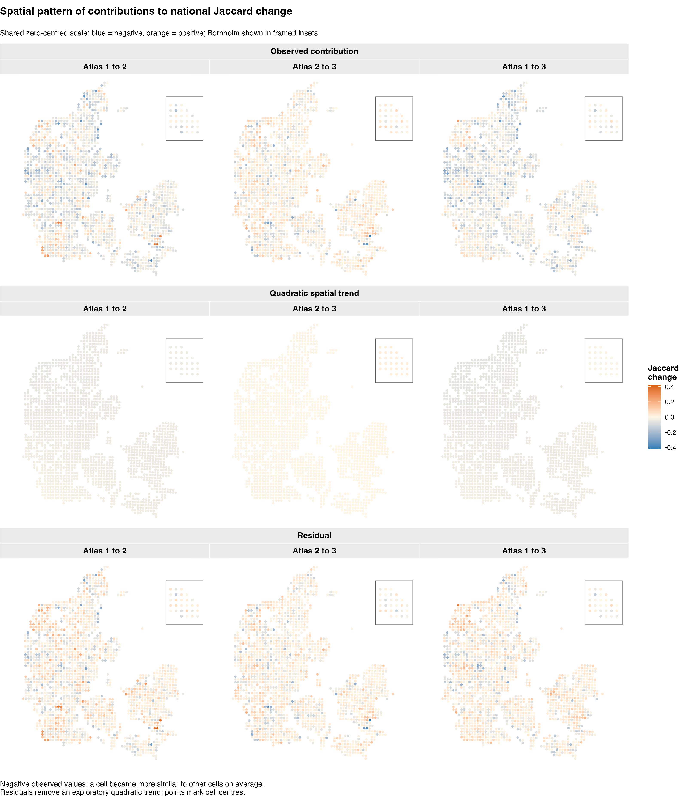

```{r setup, include=FALSE}
knitr::opts_chunk$set(echo=FALSE, message=FALSE, warning=FALSE, dev='png')
source('homogenization.R')
source('bootstrap-report.R')
source('null-report.R')
fmt <- function(x) format(x,big.mark=',',scientific=FALSE,trim=TRUE)
```

<style>
table { display: block; max-width: 100%; overflow-x: auto; }
</style>

## Question and common data

Did recorded species lists become more similar among Danish grid cells? Following question five in Carsten’s *Possibilities for Danish BirdAtlas Analysis of changes over time*, we calculate mean spatial Jaccard dissimilarity within each atlas, then compare atlas means. The spatial diagnostics below implement the first stage of investigating a paired spatial-block bootstrap; they remain exploratory. The subsequent bootstrap section compares block sizes and placements using saved runs; its intervals have not undergone coverage validation.

The analysis uses **`r fmt(N)` identical cells and `r S` species** in all three periods. Inputs are the raw occurrence matrix (`Y_occurrences.csv`), study design (`studyDesign.csv`), updated environmental matrix (`X_environment.csv`) and coverage workbook (`dækning atlas1+2.xlsx`), at the same paths and with the same filtering as the adjacent occupancy-change and unusual-temporal-turnover analyses.

Cells must have **at least 25% land in every atlas**, calculated as 100 minus ocean (`pct_class_0`) and inland water (`pct_class_77`). We require Good/Average coverage (codes 1 or 2) in Atlas 1 (`UNDS_KODE_`) and Atlas 2 (`UNDS_KOD_1`). Adequate Atlas 3 coverage is assumed, not measured by that workbook. We retain all 201 upstream species, including species absent from an individual atlas, without adding a rarity filter. Missing/nonbinary records or empty communities stop the analysis. There are `r paste(empty,collapse=', ')` empty communities in Atlases 1, 2 and 3.

## Observed national change

Jaccard dissimilarity divides species recorded in only one member of a cell pair by species recorded in either member. Shared absences do not enter its denominator. Each of the **`r fmt(choose(N,2))` unordered pairs of distinct cells** receives equal weight. Negative later-minus-earlier changes indicate homogenisation; positive changes indicate heterogenisation.

```{r national-tables}
knitr::kable(atlas_summary,digits=6)
knitr::kable(changes,digits=6)
```

```{r national-plots, out.width='100%'}
knitr::include_graphics(c('homogenization-atlas-means.png','homogenization-changes.png'))
```

These are changes in recorded species-list similarity, not abundance or detection-corrected occurrence. Atlas spacing in the plot is categorical, not an annual rate. The 1–3 comparison overlaps the two adjacent intervals.

## Stage one: spatial pattern of cell contributions

For a comparison from atlas \(t\) to \(u\), define

\[
c_i=\frac{1}{N-1}\sum_{j\ne i}\{d_J(X_{i,u},X_{j,u})-d_J(X_{i,t},X_{j,t})\}.
\]

This is a cell’s average change in dissimilarity to **all other common cells**, including distant cells. A negative value means its species list became more similar to other cells on average. It is neither the temporal Jaccard of that cell’s own history nor a local-neighbourhood statistic. The mean of these contributions exactly equals the national change in mean spatial Jaccard.

Every contribution shares comparisons with the rest of the grid. These values are therefore **spatial diagnostics, not independent observations for a test**. Any subsequent bootstrap must retain the full paired atlas histories and calculate the national pairwise statistic.

### Broad trend and residuals

Coordinates are matched by cell identifier, checked across atlases and transformed from longitude/latitude to ETRS89 / UTM zone 32N (EPSG:25832). Distances are in kilometres. For each comparison we fit an exploratory quadratic surface using centred, scaled easting and northing: east, north, east², north² and east × north. Residuals subtract this surface from the cell contributions. This separates broad gradients from remaining structure without changing the original national result.

The following R² values describe how much of the observed variation in cell contributions is represented by this surface. They are descriptive fit summaries, not significance tests or ecological explanations.

```{r trend-table}
knitr::kable(trend_summary,digits=4,row.names=FALSE,
  col.names=c('Atlas comparison','Quadratic trend R²','Raw SD','Residual SD'))
```

```{r spatial-map, out.width='100%'}

```

One zero-centred colour scale is shared across all nine panels. Circular points mark retained cell centres, not surveyed land area or exact cell polygons. Following the temporal-turnover map style, axes and grid lines are omitted, panels have grey headers, and Bornholm is shown in a framed inset in each map. All common cells are retained.

## Stage one: spatial dependence by distance and direction

For each distance bin we calculate the empirical semivariance, the average of \((c_i-c_j)^2/2\) over unordered cell pairs in that bin. We repeat the calculation for residuals. Values are divided by the sample variance of the corresponding raw or residual field, making their relative scales comparable. A value near one means semivariance is near the field variance; **it does not establish independence**. Broad trends, shared comparisons and the irregular retained-cell mask affect these curves.

Bins are (0,10], (10,20], …, (190,200] km, plotted at their midpoints. These diagnostics use a 200-km display limit; the national statistic and cell contributions still use every cell pair. Omnidirectional curves use all bearings. East–west and north–south curves use ±22.5° sectors around their respective axes, treating opposite bearings as equivalent. The two directional sectors do not overlap; diagonal pairs enter only the omnidirectional curve.

Open symbols flag bins with fewer than 100 cell pairs. That is a display convention, not a threshold for adequate effective sample size. Empty bins have undefined semivariance. Pair counts are shown because directional coverage and long-distance comparisons can differ markedly.

```{r variograms, out.width='100%'}
knitr::include_graphics(c('homogenization-variogram-raw.png','homogenization-variogram-detrended.png'))
```

```{r pair-count-table}
knitr::kable(regional_diagnostic_summary,row.names=FALSE,
  col.names=c('Comparison','Field','Direction','Populated bins','Sparse populated bins','Minimum pairs','Maximum pairs'))
```

## Findings from this run

The quadratic surface accounts for **`r sprintf('%.1f',100*min(trend_summary$spatial_R_squared))`–`r sprintf('%.1f',100*max(trend_summary$spatial_R_squared))`%** of the spatial variation in cell contributions across the three comparisons. Most variation therefore remains after removing this particular broad trend; this does not rule out more complicated regional patterns.

At 0–10 km, the raw omnidirectional semivariance is **`r sprintf('%.2f',min(subset(variogram_summary,field=='Raw' & direction=='Omnidirectional' & bin==1)$relative_semivariance))`–`r sprintf('%.2f',max(subset(variogram_summary,field=='Raw' & direction=='Omnidirectional' & bin==1)$relative_semivariance))` times the field variance**. Nearby cell contributions are more alike on this diagnostic than the reference value of one would suggest. Beyond the first few bins, the curves are uneven and direction-dependent; they do not identify a single clear national cutoff. In particular, east–west and north–south behaviour differs at larger distances, and the broad quadratic adjustment leaves much of that pattern in place.

All displayed bins contain at least **`r fmt(min(variogram_summary$pairs))` pairs**, so none is flagged as sparse by the 100-pair display rule. These large counts do not imply independent replication. The appropriate next investigation is block-width and layout sensitivity, with attention to regional representation; no block size has been selected here.

## What these diagnostics can establish

Look for smooth geographical gradients, differences between east–west and north–south curves, and how much structure remains after detrending. Short-distance semivariance below the field variance is compatible with nearby contributions being more similar than widely separated ones. A rising curve without a clear plateau leaves the dependence scale unresolved within the displayed distances. A plateau is exploratory evidence, not proof that blocks beyond that width are independent.

Raw and residual curves answer different questions: the latter condition on the fitted broad trend. A short residual scale does not by itself justify unrestricted resampling across regions with different mean changes. Any regional stratification would need to be specified and assessed separately. No block width is selected from these plots. The bootstrap sensitivity analysis follows below; coverage simulation remains deferred.

Spatial block-size research shows that dependence and study-region geometry both matter ([Nordman & Lahiri, 2004](https://doi.org/10.1214/009053604000000779)). Block-bootstrap theory for pairwise averages exists under particular dependence assumptions, but the sequence-based results do not directly validate this Danish spatial application ([Dehling & Wendler, 2010](https://arxiv.org/abs/0811.1888)). Our cell-contribution maps and quadratic detrending are exploratory diagnostic choices, not a validated automatic block-selection procedure.

## Paired spatial-block bootstrap sensitivity

```{r bootstrap-status, results='asis'}
if(!bootstrap_available) cat('**Bootstrap not run.** Run `Rscript scripts/1-atlas-analyses/homogenization/run-spatial-bootstrap.R` from the repository root, then render this report again.\n')
if(bootstrap_available) cat(sprintf('Completed run: `%s`. **%s replicates**: %s per seed batch, two independent batches, 16 configurations.\n',basename(bootstrap_run_dir),fmt(nrow(boot$draws)),fmt(boot$metadata$replicates_per_batch)))
```

### Resampling and interpretation

We compare square blocks of 10, 20, 40 and 80 km. Each has four origins: an unshifted lattice anchored at projected coordinate zero, a half-block east shift, a half-block north shift, and both. Every common cell belongs to exactly one occupied block per layout. Empty blocks are discarded; partial coastal blocks remain.

For a layout with K occupied blocks, each replicate draws K blocks uniformly with replacement. The complete species records from **all three atlases move together**. Large and small occupied blocks have equal selection probability; their differing cell counts mean the total number of resampled histories varies. Repeated copies are retained, including their zero-distance comparisons. Original empty communities stop data preparation, so no undefined empty-community distances arise during resampling.

The raw occurrence histories, rather than the detrended contributions, define this bootstrap. We calculate all within- and between-block distances, preserving equal weight per unordered pair in the expanded dataset. The fast calculation uses ordered block-distance sums A and sampled multiplicities m: mᵀAm / [n*(n*−1)], where n* is the total number of resampled cell histories. It is validated against explicitly duplicated occurrence matrices. No cell-pair approximation is used.

**These are exploratory uncertainty intervals under a spatial-process interpretation.** They are not detection-error intervals or fixed-gain/loss null tests. Neither interval type nor block configuration is chosen according to whether it excludes zero. Configurations and seed batches are analysed separately, not pooled. Regional stratification, different block shapes and simulation-based coverage validation are deferred.

### Block layouts and occupancy

Each colour identifies an occupied block within a layout. Pale square boundaries show the resampling blocks; points show common cells. Colours match between mainland and Bornholm inset within a panel but do not imply correspondence between different layouts.

```{r bootstrap-layouts, out.width='100%'}
if(bootstrap_available) knitr::include_graphics(file.path(bootstrap_run_dir,paste0('block-layouts-',c(10,20,40,80),'km.png')))
```

```{r bootstrap-geometry}
if(bootstrap_available) knitr::kable(geometry_summary,row.names=FALSE)
```

### Changes, displacement and intervals

Percentile intervals are the 2.5th and 97.5th percentiles of bootstrap changes. Basic intervals reflect those endpoints around the observed change: [2Δobserved − q97.5, 2Δobserved − q2.5]. Points show bootstrap means; they are not necessarily interval midpoints. Mean-minus-observed displacement diagnoses bootstrap centring and should not automatically be interpreted as the estimator's true bias.

```{r bootstrap-interval-plots, out.width='100%'}
if(bootstrap_available) knitr::include_graphics(file.path(bootstrap_run_dir,paste0('intervals-batch-',1:2,'.png')))
```

```{r bootstrap-interval-table}
if(bootstrap_available) knitr::kable(bs[c('config','batch','pair','observed','bootstrap_mean','displacement','se','percentile_low','percentile_high','basic_low','basic_high')],digits=6,row.names=FALSE)
```

### Findings across configurations

```{r bootstrap-findings, results='asis'}
if(bootstrap_available) {
  ranges<-do.call(rbind,lapply(split(bs,interaction(bs$width_km,bs$pair)),function(z)
    data.frame(width_km=z$width_km[1],pair=z$pair[1],minimum_SE=min(z$se),maximum_SE=max(z$se))))
  print(knitr::kable(ranges,digits=6,row.names=FALSE,
    caption='Range of standard errors across origins and seed batches; draws are not pooled.'))
  cat('\nUncertainty generally increases with block width, especially for comparisons 1–2 and 1–3. The 80-km layouts have relatively few blocks and allow substantially more variation in spatial representation. These results do not identify a preferred block width.\n\n')
  for(pair_i in names(boot$observed)) {
    z<-bs[bs$pair==pair_i,]
    cat(sprintf('For %s: %d of %d percentile intervals and %d of %d basic intervals lie entirely below zero. This describes the tested configurations, not calibrated coverage or an independent hypothesis test.\n\n',
      pair_i,sum(z$percentile_high<0),nrow(z),sum(z$basic_high<0),nrow(z)))
  }
  cat(sprintf('The largest absolute difference in bootstrap standard error between seed batches is %.6f. Seed agreement addresses Monte Carlo variability only.\n',max(abs(stability$se_difference))))
}
```

### Repeated histories and spatial representation

Unique-cell counts quantify the original cells represented at least once. The duplicate-pair fraction is the fraction of expanded cell pairs comparing repeated copies of the same original cell; it does not count other pairs that happen to have identical species lists. Those zero distances remain in the denominator. Strong displacement should be investigated alongside this fraction, block occupancy and regional representation.

```{r bootstrap-resampling, out.width='100%'}
if(bootstrap_available) knitr::include_graphics(file.path(bootstrap_run_dir,'resampling-diagnostics.png'))
```

```{r bootstrap-resampling-table}
if(bootstrap_available) knitr::kable(replicate_summary,digits=5,row.names=FALSE)
```

The spatial audit divides the original cells into four fixed quadrants at their median projected easting and northing, using <= median for west and south. These are descriptive regions, not ecological strata. We track the fraction of resampled histories in each quadrant, including repeated copies. The plotted ranges describe variability in representation; they are not confidence intervals for original regional shares.

```{r bootstrap-regions, out.width='100%'}
if(bootstrap_available) knitr::include_graphics(file.path(bootstrap_run_dir,'spatial-representation.png'))
```

### Influential blocks and seed stability

Leave-one-block-out changes show how much the estimate changes when one observed block is omitted, with no replacement. This is an influence diagnostic, not another bootstrap interval. The table lists the five largest absolute shifts per comparison across configurations, with their layout-specific block IDs.

```{r bootstrap-influence, out.width='100%'}
if(bootstrap_available) knitr::include_graphics(file.path(bootstrap_run_dir,'block-influence.png'))
```

```{r bootstrap-influence-table}
if(bootstrap_available) knitr::kable(influence_top,digits=6,row.names=FALSE)
```

The second independent seed batch checks Monte Carlo stability. Differences below are batch 2 minus batch 1. Agreement across seed batches addresses numerical simulation noise; it does not establish statistical coverage.

```{r bootstrap-stability-table}
if(bootstrap_available) knitr::kable(stability,digits=6,row.names=FALSE)
```

### Checks, provenance and rerunning

The runner verifies that selecting every block once reproduces observed means, that duplicate-history weighting agrees with explicit occurrence-matrix expansion on synthetic and real examples, and that Δ1–2 + Δ2–3 equals Δ1–3 in every replicate. Seed reproducibility and independence from numerical batch size are checked. Saved runs contain draws, block membership, influence diagnostics, settings, input/code hashes, package versions, a progress log and a completion marker. The latest-run pointer is updated only after completion. Report rendering rejects results incompatible with current inputs or bootstrap calculation code.

```sh
Rscript scripts/1-atlas-analyses/homogenization/run-spatial-bootstrap.R --replicates=2000 --seed=20261105
Rscript -e 'rmarkdown::render("scripts/1-atlas-analyses/homogenization/homogenization.Rmd")'
```

```{r bootstrap-provenance}
if(bootstrap_available) {
  print(boot$metadata[c('generated','replicates_per_batch','seed','batches','projection','validation')])
  knitr::kable(data.frame(input_or_code=names(boot$metadata$input_code_hashes),md5=unname(boot$metadata$input_code_hashes)),row.names=FALSE)
}
```

## Conditional allocation null: spatial homogenisation

```{r null-status, results='asis'}
if(!null_available) cat('**Null simulations not run.** Run `Rscript scripts/1-atlas-analyses/homogenization/run-homogenization-null.R`, then render again.\n')
if(null_available) cat(sprintf('Completed run: `%s`. **%s simulations per atlas comparison**, on the same %s common cells and %s species.\n',basename(null_run_dir),fmt(null$metadata$settings$simulations),fmt(length(null$sites)),nrow(null$constraints[[1]])))
```

### Question and constraints

Given the observed gains and losses of each species, did their geographical allocation produce more or less spatial differentiation than independent random allocation would predict? This question differs from the paired bootstrap, which assesses spatial-process uncertainty by resampling observed histories.

For each comparison the observed earlier atlas is held fixed. For each species, the null independently selects its observed number of losses uniformly without replacement among earlier occupied cells, and its observed number of gains uniformly without replacement among earlier unoccupied cells. Losses and gains are applied to a fresh copy of the baseline for every simulation.

This fixes every species' baseline distribution, transition totals and later occupancy. The later range-size distribution, national species richness, total occupancy and mean cell richness are therefore fixed. Individual cells' later richness and the arrangement of occurrences can vary. There are no geographical, habitat or adjacency restrictions, and no spatial blocks are used in this allocation null.

Each comparison is a separate conditional experiment. In particular, 1–3 does not simulate a trajectory through a random Atlas 2; its simulated change need not equal the sum of simulated 1–2 and 2–3 changes.

### Data and filtering audit

The runner sources the same validated data helper as the observed and bootstrap analyses: land at least 25% in every atlas, Good/Average coverage in Atlases 1 and 2, adequate Atlas 3 coverage assumed, common cells in every period, all 201 upstream species. Binary values are checked before conversion and missing records are not recoded. The following counts are sequential; the final count must equal the observed-analysis sample.

```{r null-filter-audit}
if(null_available) knitr::kable(null$filter_audit,row.names=FALSE)
```

### Statistic and numerical calculation

Each simulation calculates mean spatial Jaccard across every unordered pair of distinct cells in its later matrix, and subtracts the fixed observed earlier mean. All 1,440,753 pairs receive equal weight. The compiled implementation uses species bit sets and exact shared-species counts; it does not approximate by sampling cell pairs. Observed values from that implementation are checked against the existing R calculation.

An empty observed or simulated community stops execution. A failed simulation is not discarded, redrawn or silently assigned a distance; its chunk seed, draw position and cell-index diagnostic are saved with completed checkpoints for investigation. The baseline sample stays fixed.

### Observed change versus the null

```{r null-main-plot, out.width='100%'}
if(null_available) knitr::include_graphics(file.path(null_run_dir,'null-distributions.png'))
```

```{r null-effect-table}
if(null_available) {
  effect_table<-null_table[c('pair','observed_delta','null_mean','null_sd','null_q025','null_q975','observed_minus_null')]
  effect_table[-1]<-lapply(effect_table[-1],function(x) sprintf('%.7f',x))
  knitr::kable(effect_table,row.names=FALSE,col.names=c('Atlas pair','Observed change','Null mean','Null SD','Null 2.5%','Null 97.5%','Observed minus null'))
}
```

The central 95% null range describes simulated allocations; it is **not a confidence interval for the observed change**. Observed-minus-null-mean measures departure from this conditional expectation.

```{r null-interpretation, results='asis'}
if(null_available) for(i in seq_len(nrow(null_table))) {
  z<-null_table[i,]
  wording<-if(z$observed_delta<0 && z$observed_minus_null>0) 'observed homogenisation is weaker than the null mean predicts' else
    if(z$observed_delta<0 && z$observed_minus_null<0) 'observed homogenisation is stronger than the null mean predicts' else
    if(z$observed_delta>0 && z$observed_minus_null<0) 'observed heterogenisation is weaker than the null mean predicts' else
    if(z$observed_delta>0 && z$observed_minus_null>0) 'observed heterogenisation is stronger than the null mean predicts' else 'the observed and null mean changes coincide or one is zero'
  cat(sprintf('**Atlas %s:** observed change %.7f; null mean %.7f; %s. The two-sided Holm-adjusted Monte Carlo p-value is %.5g. This comparison is conditional on the unrestricted independent-allocation null.\n\n',z$pair,z$observed_delta,z$null_mean,wording,z$p_holm))
}
```

```{r null-zoom-plot, out.width='100%'}
if(null_available) knitr::include_graphics(file.path(null_run_dir,'null-distributions-zoom.png'))
```

### Tails, multiplicity and Monte Carlo precision

Both directions are reported. The inclusive lower tail counts simulations <= observed, and the inclusive upper tail counts simulations >= observed. Each p-value is (tail count + 1)/(simulations + 1). The two-sided p-value is twice the smaller tail, capped at one. Holm adjustment covers the three national two-sided comparisons, separately from the temporal-turnover site's test family. A pre-specified tail is not selected after inspecting the observed direction.

```{r null-tail-table}
if(null_available) knitr::kable(null_table[c('pair','simulations','below','equal','above','p_lower','p_upper','p_two_sided','p_holm','minimum_one_sided_p')],digits=7,row.names=FALSE)
```

Exact binomial 95% intervals below describe Monte Carlo uncertainty in the underlying inclusive tail probabilities, using tail counts without the add-one correction. They are not uncertainty intervals for spatial homogenisation. When no draw reaches a tail, the corrected p-value is bounded by the simulation resolution; it does not imply a zero probability.

```{r null-mc-table}
if(null_available) knitr::kable(null_table[c('pair','lower_tail_mc_low','lower_tail_mc_high','upper_tail_mc_low','upper_tail_mc_high')],digits=7,row.names=FALSE)
```

```{r null-zero-tails, results='asis'}
if(null_available) for(i in seq_len(nrow(null_table))) {
 z<-null_table[i,]
 if(z$below+z$equal==0 || z$above+z$equal==0) cat(sprintf('For %s, at least one inclusive tail has zero simulated exceedances: the smallest reportable one-sided p-value is %.7f and the corresponding minimum two-sided value is %.7f. More draws would refine that tail.\n\n',z$pair,z$minimum_one_sided_p,2*z$minimum_one_sided_p))
}
```

### Execution, storage and validation

```sh
Rscript scripts/1-atlas-analyses/homogenization/run-homogenization-null.R --simulations=9999 --seed=20261105 --chunk-size=250 --workers=6
Rscript scripts/1-atlas-analyses/homogenization/run-homogenization-null.R --resume=/absolute/path/to/incomplete-run --workers=6
Rscript scripts/1-atlas-analyses/homogenization/validate-homogenization-null.R
```

The runner saves results under `null-results/independent-change/` in a unique run folder. `null-results.RData` contains each draw's later mean and signed change, observed statistics, inference, ordered cell manifest and coordinates, filter counts, per-species transition constraints, settings and seed schedule, input/code hashes, package/compiler provenance and validation information. `settings.rds`, the progress log and run-status marker support auditing and resumption. PNG figures are generated when rendering this report.

It does not retain simulated occurrence matrices, distance matrices, cell-pair arrays or site-level temporal-turnover results. Completed chunks are checkpointed atomically. After consolidation and read-back validation, redundant checkpoints are removed. The latest-completed-run pointer advances only after successful completion. A matching incomplete run can resume with another worker count; inputs, statistical settings, code and chunk seed schedule must match. Changing chunk size changes the seed schedule and defines a new run.

Tests cover exact Jaccard calculations, approximately uniform allocations in an enumerable example, species transition constraints, zero/full feasible changes, deterministic seeds, explicit empty-community failures, known tied tails, add-one corrections and Holm adjustment. A checkpoint-resume pilot is checked against an uninterrupted run with a different worker count. Report rendering does not compile the sampler or launch null simulations and rejects incompatible completed results.

```{r null-provenance}
if(null_available) {
 print(null$metadata[c('settings','workers','completed','compiler','compiler_version','validation')])
 knitr::kable(data.frame(input_or_code=names(null$metadata$input_code_hashes),md5=unname(null$metadata$input_code_hashes)),row.names=FALSE)
}
```

## Validation and reproduction

The script checks binary records before conversion, cell/species alignment, empty communities, unique cell pairs, distance bounds and selected direct Jaccard calculations. For these diagnostics it additionally checks:

- Mean cell contributions equal national changes within 10⁻¹².
- Cell-level 1–2 plus 2–3 changes equal 1–3 within 10⁻¹².
- Coordinates match the same cells across periods, are finite and have unique projected positions.
- Trend plus residual reconstructs each raw contribution.
- Distance-bin pair counts sum to the eligible pairs in each sector; directional sectors do not overlap.
- Selected semivariances agree with direct squared-difference calculations.

From the repository root:

```sh
Rscript -e 'rmarkdown::render("scripts/1-atlas-analyses/homogenization/homogenization.Rmd")'
```

Rendering reruns the analysis and regenerates the PNG figures and README. The script can also run from the repository root or this analysis directory. Numerical results remain available in `cell_diagnostics`, `trend_summary` and `variogram_summary` when the script is sourced. The explicit bootstrap runner saves its draws and provenance in a run-specific RData file. Rendering reads those results and regenerates PNGs, without launching the bootstrap.

```{r session-details}
sessionInfo()
```
