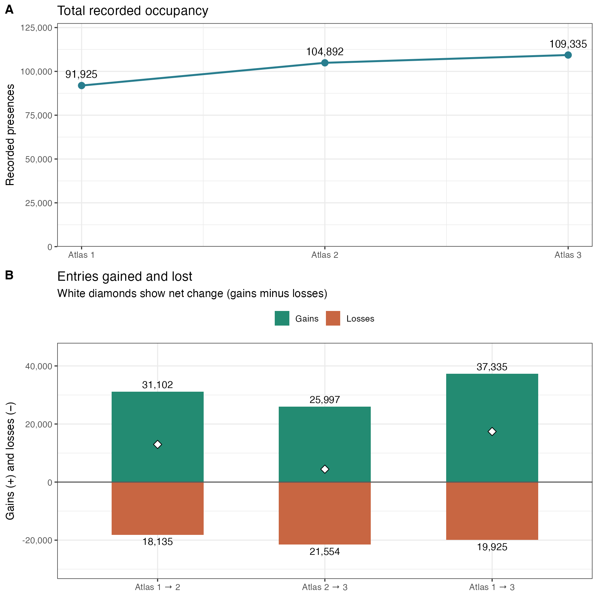
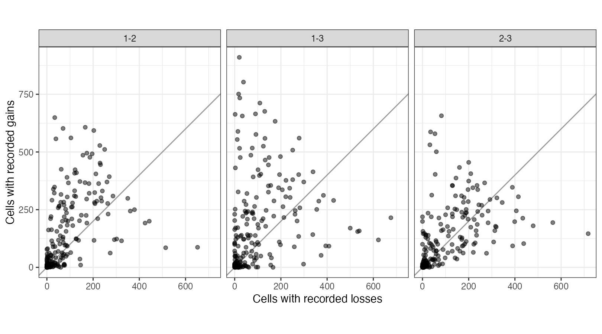
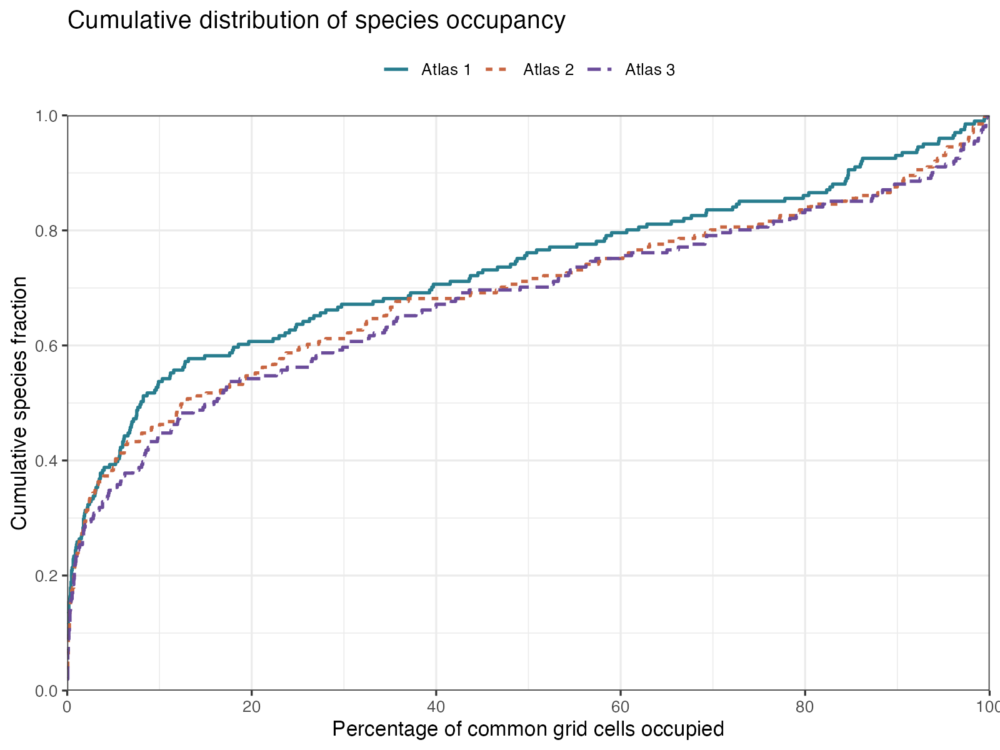
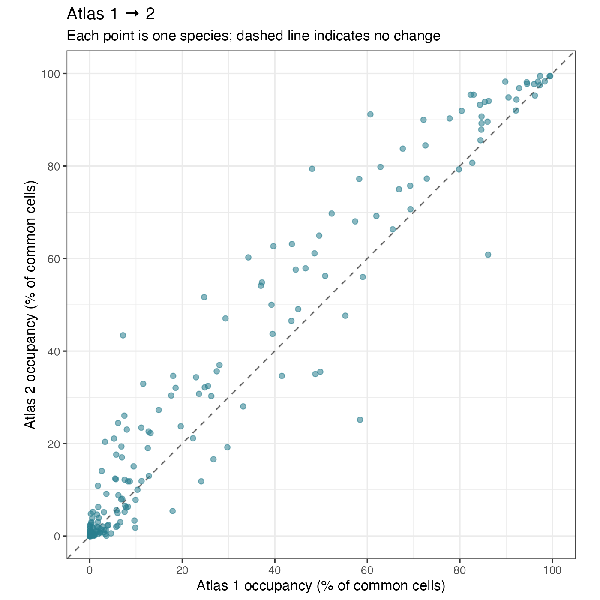
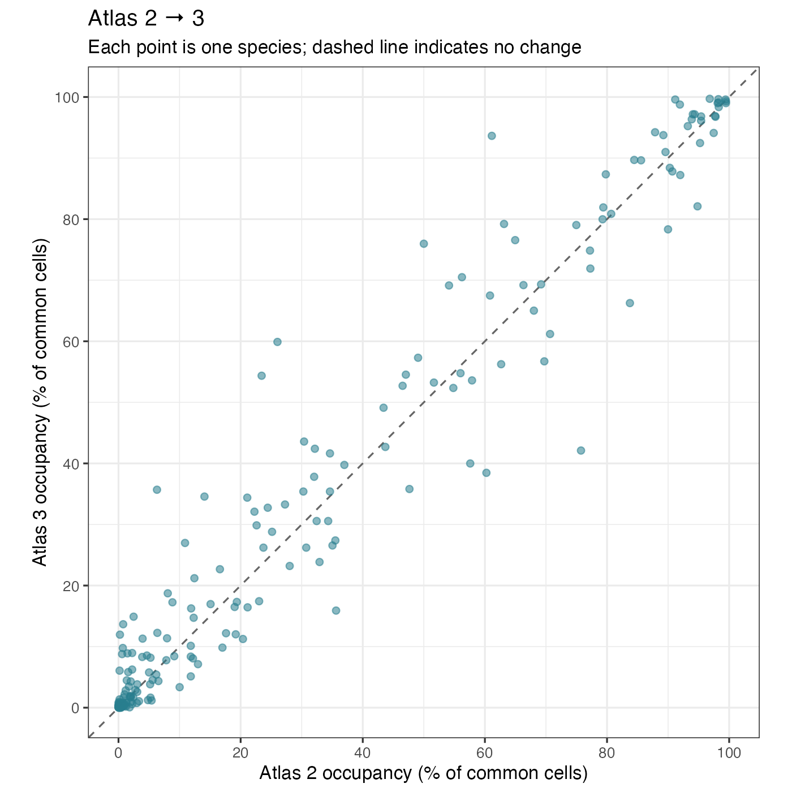

```{r setup, include=FALSE}
knitr::opts_chunk$set(echo=FALSE, message=FALSE, warning=FALSE, dev='png')
source('occupancy-change-rsfd.R')
```

## Methods

We matched cells by their grid-cell identifier and atlas number, rather than row position. For each cell-period we summed `pct_class_0` (ocean) and `pct_class_77` (inland water) from the updated `data-new/0-pre/derived/environmental/X_environment.csv`; cells with a sum above 75% were excluded. The same cells must pass that rule in all three atlases. We then retained Good/Average survey coverage in Atlases 1 and 2 using the supplied effort workbook. Adequate Atlas 3 coverage is assumed, not measured. We no longer inherit filtering from the older S0 preprocessing object. These restrictions define the analysis population; results need not represent all Danish cells.

We recovered all species columns from `data-new/0-pre/raw/occurrences/Y_occurrences.csv`, preserving upstream taxonomy and occurrence definitions without the model's minimum-five-records-per-atlas filter. Matrices were aligned to identical cells and species. Missing surveys or nonbinary/missing entries cause validation to fail; missing observations are never converted to absences.

For each atlas we counted recorded presences across species and cells and summarised cell richness. Pairwise comparisons use the same cells and species for Atlases 1–2, 2–3 and 1–3. The definitions and denominators are explained below. Persistence, loss and gain rates and Jaccard change are calculated in memory: persistence and loss rates divide by earlier presences; gain rate divides by earlier absences; Jaccard change divides changed entries by entries occupied in either atlas. Undefined ratios are NA.

These are descriptive changes in recorded occurrence, not abundance, detection-corrected occupancy, or demonstrated colonisation and extinction. Intervals are not annualised. No independence-based significance tests are applied.

## Sample and atlas occupancy

The fixed sample contains **`r N` cells × `r S` species**, or **`r format(total,big.mark=',')` entries per atlas**.

```{r}
knitr::kable(atlas_summary,col.names=c('Atlas','Cells','Species','Recorded presences','Possible entries occupied (%)','Mean species per cell'),digits=2)

```

Panel A shows total recorded presences. Panel B shows gains above zero and losses below zero for each comparison; losses are plotted as negative values only to show direction. White diamonds mark gains minus losses, which equals the difference between the corresponding occupancy totals in Panel A. Atlas positions are categorical and the connecting line does not estimate an annual rate. The 1–3 comparison overlaps the two adjacent intervals and must not be added to them. All panels use the same cells and species.

## Understanding the counts

An **entry** is one species in one cell. A species recorded in ten cells contributes ten presences. It is not a count of birds. Here there are `r format(total,big.mark=',')` possible entries in each atlas, including absences.

| Term | What happens to one species in one cell? |
|:--|:--|
| Persistent presence | Recorded in both atlases (1 → 1). |
| Loss | Recorded in the earlier atlas, absent in the later atlas (1 → 0). |
| Gain | Absent in the earlier atlas, recorded in the later atlas (0 → 1). |
| Continued absence | Absent in both atlases (0 → 0). |
| Changed entries | Losses **plus** gains: all entries that switched status. |
| Net change in presences | Gains **minus** losses: the increase or decrease in the total number of presences. |

**Illustrative example:** suppose one species occupied 10 cells initially. It remains recorded in 8, loses 2, and gains 3 other cells. It now occupies 11 cells. Five entries changed (2 + 3), but the net increase is only one presence (3 − 2).

### Counts in our data

```{r}
knitr::kable(pairwise[,c('pair','earlier','later','persistence','losses','gains','continued_absence')],col.names=c('Atlas pair','Earlier presences','Later presences','Present in both','Losses','Gains','Absent in both'))
knitr::kable(pairwise[,c('pair','changed','net')],col.names=c('Atlas pair','Entries that switched status (losses + gains)','Net change in presences (gains − losses)'))
```

## Understanding the percentages

A percentage is a count divided by a reference total, multiplied by 100. **The reference total differs between these two questions:**

- **What percentage of all possible entries switched status?** Divide losses plus gains by all `r format(total,big.mark=',')` entries. This describes how much of the whole occurrence matrix changed.
- **By what percentage did the number of presences increase or decrease?** Divide gains minus losses by the number of presences in the earlier atlas. This describes the size of the net change relative to the starting occupancy.

In the illustrative example, if 20 cells were surveyed, 5/20 = 25% of entries switched status. Occupancy nevertheless increased by only 1/10 = 10% relative to the initial ten occupied cells. These percentages answer different questions.

```{r}
knitr::kable(pairwise[,c('pair','changed_percent','relative_change_percent')],col.names=c('Atlas pair','All possible entries that switched status (%)','Net change relative to earlier presences (%)'),digits=2)
```

For Atlases 1–3, `r format(pairwise$losses[3],big.mark=',')` losses plus `r format(pairwise$gains[3],big.mark=',')` gains give `r format(pairwise$changed[3],big.mark=',')` changed entries: **`r round(pairwise$changed_percent[3],2)`% of all possible entries**. Gains exceeded losses by `r format(pairwise$net[3],big.mark=',')` presences: **a `r round(pairwise$relative_change_percent[3],2)`% increase relative to Atlas 1's `r format(pairwise$earlier[3],big.mark=',')` presences**.

The occupied percentage in the atlas summary instead divides presences in that atlas by all possible entries. Its difference between atlases is measured in **percentage points**, not relative percent change.

## Species gains and losses

```{r}

```

Each point is a species. Its horizontal position is the number of cells where it was lost; its vertical position is the number where it was gained. Above the line, gains exceed losses; below it, losses exceed gains. A species can have many of both while having little net change.

## Range-size frequency distribution

For every species and atlas, we divided its number of occupied cells by the same `r N` common cells and multiplied by 100. Each curve is the empirical cumulative distribution of these percentages across the same `r S` species. At any horizontal value, its height is the fraction of species occupying **at most** that percentage of cells. Ties enter the curve together. Species with no records in an individual atlas remain at 0% occupancy and are retained in the species denominator.

```{r}

```

For example, (20%, 0.6) would mean that 60% of species occupy no more than 20% of the sampled cells. A curve shifted rightwards indicates larger recorded ranges overall; a curve shifted leftwards indicates smaller ranges. Crossing curves indicate that changes differ across the occupancy distribution. These distributions summarise the species pool, while species-level changes require the paired species table. Range size here refers to occupancy within the common sampled cells, rather than total geographic range area.

The script keeps the species counts and cumulative fractions in memory for plotting. Checks verify a fixed species denominator, monotonic cumulative fractions, the zero-occupancy boundary and a final cumulative fraction of one for each atlas.

### Species-matched occupancy comparisons

Each point represents the **same species** in two atlases. The horizontal axis shows earlier occupancy and the vertical axis shows later occupancy, both as the percentage of the same common grid cells occupied. All `r S` species are included, including species with zero occupancy in either atlas. Both plots use identical 0–100% scales and equal axis lengths.

The dashed equality line indicates unchanged occupancy. Points above it indicate increased occupancy; points below it indicate decreased occupancy. Unchanged occupancy can still involve gains and losses in different cells. The paired values are held in memory while the figures are generated.

```{r}


```

## Reproducibility and validation

The adjacent R script regenerates all CSVs and PNGs. Detailed species occupancy, cell richness, species transitions, cell transitions and common-cell identifiers are saved alongside this report with the `occupancy-change-` prefix. Checks confirm binary complete matrices, unique input identifiers, transition totals, and agreement between net change and the difference in occupancy. Species and cell summaries reproduce atlas totals. All checks passed during this render.

```{r}
sessionInfo()
```

